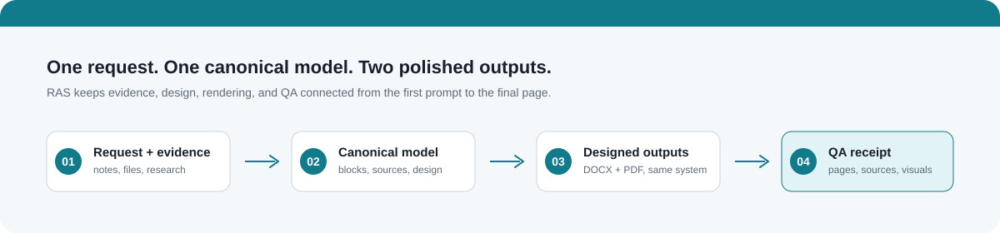
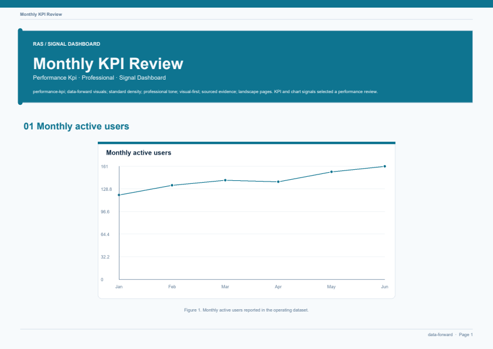
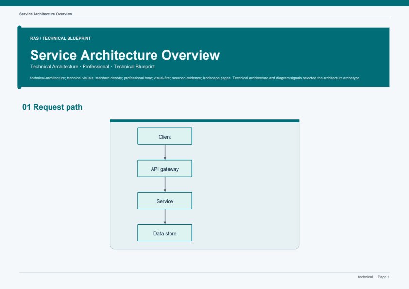
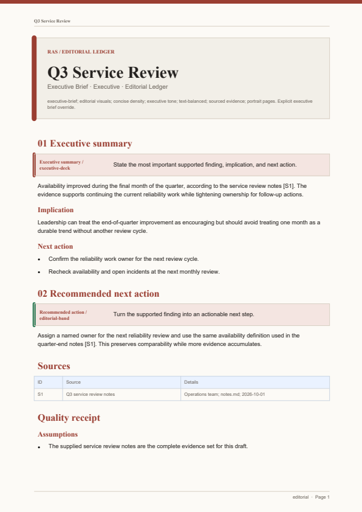
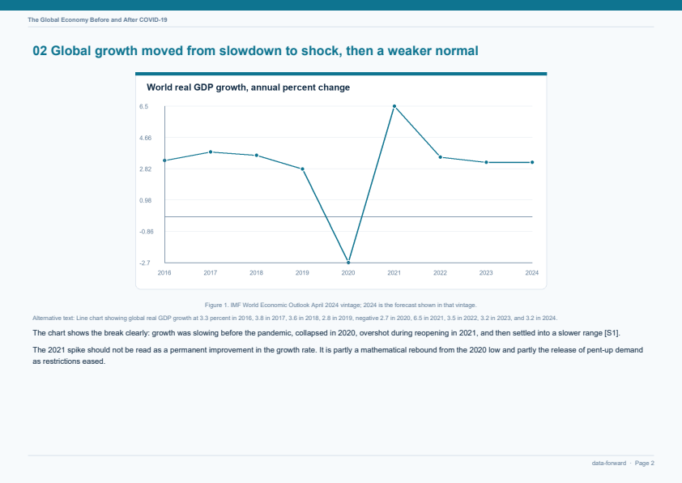
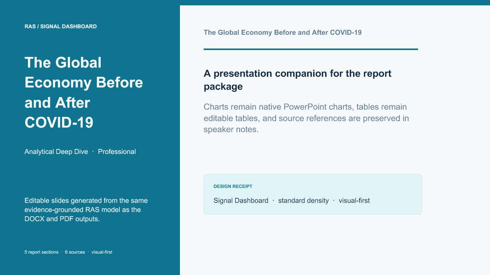
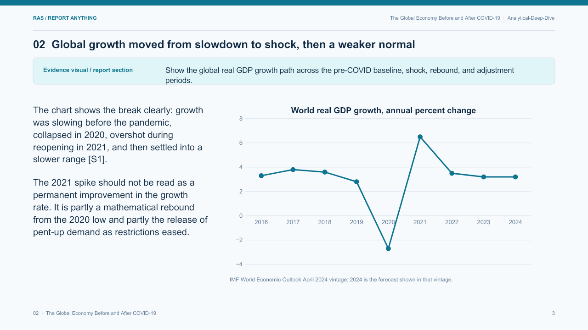
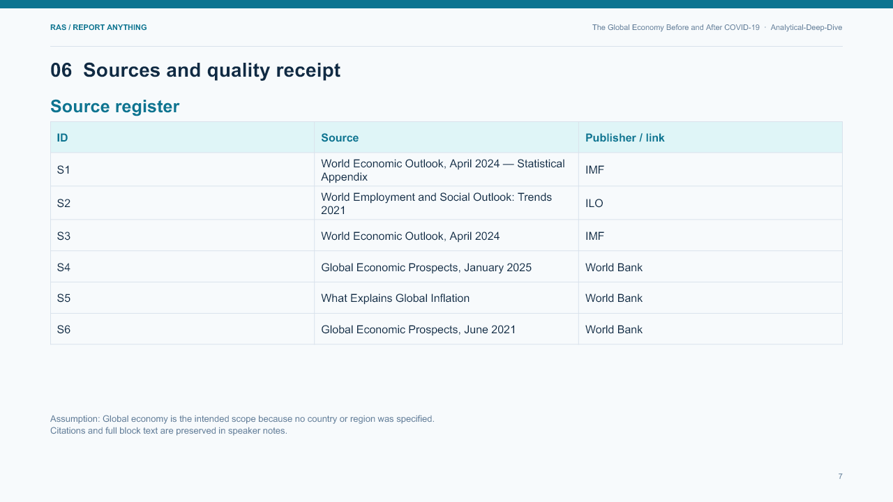

<div align="center">



# RAS — Report Anything Skill

### リクエストと根拠を、実際に読まれるレポートへ。

Codex と Claude Code で使えるスキル · 6 つのビジュアルテーマ · 16 個のテンプレート · DOCX、PDF、オプションの編集可能な PPTX

[English](README.md) ·
<a href="README.zh-CN.md">简体中文</a> ·
<a href="README.zh-TW.md">繁體中文</a> ·
<a href="README.ja.md">日本語</a> ·
<a href="README.ko.md">한국어</a> ·
<a href="README.es.md">Español</a> ·
<a href="README.fr.md">Français</a> ·
<a href="README.de.md">Deutsch</a> ·
<a href="README.pt-BR.md">Português (Brasil)</a> ·
<a href="README.ru.md">Русский</a>


</div>

## RAS とは

多くのレポート自動化は文章で止まります。RAS はレポートを設計済みで監査可能な成果物として扱い、目的に合うコミュニケーション形式を選び、根拠の経路を保持し、ビジュアルシステムを解決し、同じモデルから DOCX と PDF を生成し、オプションで編集可能な PPTX を追加し、納品前に出力を検証します。

自然な言葉で結果を依頼できます。

> 「取締役会向けに選択肢を比較し、方針を提案して。」

> 「明確なトレンドチャート付きの KPI レビューを作成して。」

> 「この調査を根拠付きの統合レポートにして。」

> 「インシデント、根本原因、影響、是正措置を説明して。」

RAS は、独立した Markdown ブロック、ソース台帳、ビジュアル契約、品質レシートを持つ構造化プロジェクトに変換します。

### ローカライズされたドキュメント

[简体中文](README.zh-CN.md)、[繁體中文](README.zh-TW.md)、[日本語](README.ja.md)、[한국어](README.ko.md)、[Español](README.es.md)、[Français](README.fr.md)、[Deutsch](README.de.md)、[Português (Brasil)](README.pt-BR.md)、[Русский](README.ru.md) で読めます。RAS はレポートブロック内の Unicode 文字を保持し、ローカライズされた出力向けに CJK フォールバックフォントも設定できます。

**RAS を使う:** [Codex または Claude Code にインストール](#install-guide)。

## デモ

以下のプレビューは、このリポジトリの例と受け入れテストからレンダリングされたものです。

<table>
  <tr>
    <td width="50%"></td>
    <td width="50%"></td>
  </tr>
  <tr>
    <td align="center"><sub>データ重視の KPI レビュー</sub></td>
    <td align="center"><sub>技術アーキテクチャレポート</sub></td>
  </tr>
</table>

<table>
  <tr>
    <td width="50%"></td>
    <td width="50%"></td>
  </tr>
  <tr>
    <td align="center"><sub>エディトリアル・エグゼクティブブリーフ</sub></td>
    <td align="center"><sub>チャート付き分析比較</sub></td>
  </tr>
</table>

### 編集可能な PPTX コンパニオン

プレゼンテーションレンダラーは、同じレポートパッケージをワイド画面の編集可能なスライドデッキに変換します。チャートはネイティブな PowerPoint チャートとして保持され、ソース台帳は編集可能な表になり、完全なソース参照とブロック本文はスピーカーノートに保存されます。

<table>
  <tr>
    <td width="33%"></td>
    <td width="33%"></td>
    <td width="33%"></td>
  </tr>
  <tr>
    <td align="center"><sub>デッキカバー</sub></td>
    <td align="center"><sub>ネイティブチャート</sub></td>
    <td align="center"><sub>編集可能なソース台帳</sub></td>
  </tr>
</table>

<a id="install-guide"></a>

## Codex または Claude Code にインストール

RAS はレポート作成スキルで、Codex と Claude Code 用のプラグインとして配布されています。利用するエージェントにインストールしてください。`ras-report` は、直接またはスクリプトから使う場合の任意のレンダラーです。

### Codex

Codex CLI で安定版 `v0.1.0` のマーケットプレイスを追加し、プラグインをインストールします。

```bash
codex plugin marketplace add CharlesArea/ras --ref v0.1.0
codex plugin add ras@ras-marketplace
```

Codex アプリのプラグインブラウザーからインストールするには、最初のコマンドだけ実行してマーケットプレイスを登録します。次に `/plugins` を開き、**RAS — Report Anything Skill** を選んで **Install plugin** をクリックし、新しい Codex チャットで `$ras` を呼び出します。

```text
Use $ras to turn these notes into an evidence-grounded decision memo and
deliver DOCX, PDF, and an editable PPTX companion.
```

### Claude Code

Claude Code のターミナルで RAS マーケットプレイスを追加し、プラグインをインストールします。

```bash
claude plugin marketplace add CharlesArea/ras
claude plugin install ras@ras-marketplace
```

対話セッションでは `/plugin marketplace add CharlesArea/ras` の後に `/plugin install ras@ras-marketplace` を実行し、インストール範囲を選ぶこともできます。スキルは `/ras:ras`、レンダラーのセットアップは `/ras:setup` で呼び出します。[Claude Code のプラグイン導入ガイド](https://code.claude.com/docs/en/plugins/install)も参照してください。

### プラグインとマーケットプレイスのファイル

ポータブルなプラグインマニフェストは [`plugin.json`](plugin.json) です。[Codex 用](.agents/plugins/marketplace.json)と[Claude Code 用](.claude-plugin/marketplace.json)のカタログ、および[Codex 互換](.codex-plugin/plugin.json)と[Claude Code 互換](.claude-plugin/plugin.json)のマニフェストがあります。

## クイックスタート

インストールしたスキルにレポート作成を依頼します。詳細な分析、外部調査、DOCX/PDF など必要な成果物を依頼文に含めてください。

Codex の場合：

```text
$ras COVID 前後の経済を比較する、根拠に基づいた詳細なレポートを作成
してください。最新の一次資料を調査し、主な変化と限界を説明して、
DOCX と PDF で納品してください。
```

Claude Code の場合：

```text
/ras:ras COVID 前後の経済を比較する、根拠に基づいた詳細なレポートを
作成してください。最新の一次資料を調査し、主な変化と限界を説明して、
DOCX と PDF で納品してください。
```

依頼内容から `quick`、`standard`、`deep` の計画を推定します。DOCX/PDF の生成にはローカルレンダラーと Python 3.11 以降が必要です。セットアップを提案されたら承認してください。PPTX は任意の形式で、対応する Node.js と Artifact Tool を備えたホストが必要です。

## 任意：レンダラーを CLI から直接使う

ここではレンダラーを直接またはスクリプトから使う方法を説明します。スキルのインストールではありません。

```bash
python -m pip install "ras-report-anything[render] @ git+https://github.com/CharlesArea/ras.git@v0.1.0"
```

Python 3.11 以降が必要です。

レポートプロジェクトを初期化します。

```bash
ras-report init reports/my-report \
  --request "Create an evidence-grounded decision memo from these notes" \
  --archetype decision-memo
```

自然な文章から深さを推定できます。必要なら深さ、調査モード、ページ数を明示します。

```bash
ras-report init reports/economy-deep-dive \
  --request "Create a detailed comparison of the economy before and after COVID" \
  --depth deep --research web --pages 15
```

利用できるプロファイルは `quick`、`standard`、`deep` です。解決された計画は次で確認できます。

```bash
ras-report plan reports/economy-deep-dive/manifest.yaml
```

生成された `manifest.yaml`、`sources.yaml`、Markdown ブロックを編集してから、検証、ビルド、品質確認を行います。

```bash
ras-report validate reports/my-report/manifest.yaml
ras-report build reports/my-report/manifest.yaml --formats docx,pdf,pptx
ras-report qa reports/my-report/manifest.yaml
```

DOCX と PDF はコア出力で、Python のレンダー追加機能で動作します。PPTX は Node.js と Artifact Tool に対応したホストで生成できる、任意の編集可能なコンパニオンです。

### 出力形式

| 形式 | サポート | 実行環境 |
| --- | --- | --- |
| DOCX | コア出力 | Python と `python-docx` |
| PDF | コア出力 | Python と ReportLab |
| PPTX | オプションの編集可能なコンパニオン | Node.js と Artifact Tool に対応したホスト |

再利用可能なテンプレートカタログから、より充実したパッケージも作成できます。

```bash
ras-report template list
ras-report init reports/board-decision --template decision-memo \
  --request "Compare the options and recommend a path for the board"
```

ビジュアル言語は次で確認できます。

```bash
ras-report theme list
ras-report theme inspect data-forward
```

<details>
<summary><strong>レポートプロジェクトの構成</strong></summary>

```text
reports/my-report/
├── manifest.yaml       # リクエスト、スタイル、ブロック、出力、QA レシート
├── sources.yaml        # 出典と主張の根拠
├── blocks/*.md         # 独立して再開できるコンテンツ単位
├── assets/             # 提供または生成されたビジュアル
├── build/              # 正規モデルと中間ビジュアル
├── qa/                 # レシートとレンダリング済みページ画像
└── dist/               # 最終 DOCX、PDF、オプションの PPTX
```

</details>

## 作成できるもの

RAS は、構造、判断、追跡可能性が必要なレポートを支援します。

| 目的 | 例 |
| --- | --- |
| エグゼクティブブリーフ | 経営層向け要約と簡潔なレビュー |
| 意思決定メモ | 選択肢、トレードオフ、提案、次の行動 |
| 調査統合 | 複数ソースに基づく発見と結論 |
| 詳細分析 | トレンド、原因、影響、解釈 |
| 比較評価 | Before/After、製品、ベンダー、政策比較 |
| 提案とロードマップ | ビジネスケース、戦略、計画、マイルストーン |
| KPI と進捗レビュー | 指標、チャート、進捗、運用リズム |
| 監査、リスク、コンプライアンス | 統制、証拠不足、所見、緩和策 |
| 技術レポート | アーキテクチャ、システム、インシデント、調査 |
| SOP とケーススタディ | 再現可能な手順と記録された事例 |

ルーターでは 16 種類のアーキタイプを利用でき、リクエストが形式を明示している場合は明示的な上書きが優先されます。

### 再利用可能なテンプレート

テンプレートは固定レイアウトではなく、各ブロックを編集・再開できる強い初期構造です。

| テンプレート群 | 含まれる形 |
| --- | --- |
| 意思決定と比較 | 意思決定メモ、比較評価、提案・ビジネスケース |
| 調査と分析 | 調査統合、詳細分析、調査・根本原因 |
| 運用リズム | 進捗、KPI、戦略ロードマップ |
| リスクと保証 | 監査、コンプライアンス・リスク、インシデントレビュー |
| 技術と手順 | 技術アーキテクチャ、ポリシー/SOP、ケーススタディ |

`ras-report template inspect <template>` で正確なブロック構成を確認できます。

### 軽量なコンテンツ計画

新しいパッケージには、目標ページ範囲、語数範囲、スライド目標、セクションごとの語数予算を含むコンテンツ計画が自動記録されます。「詳細な分析」は deep、「簡潔なブリーフ」は quick のように選択され、根拠のない水増しを避けながら文脈、証拠、示唆、制限を広げられます。

## 仕組み

1. **リクエストをルーティング:** アーキタイプ、対象読者、トーン、根拠レベル、ページ形状、ビジュアルスタイル、密度、強調を解決します。明示的な指定が優先されます。
2. **コンテンツを計画:** 深さ、ページ数、セクション予算、調査モードを解決します。外部調査には明示的な `web` モードまたは明確な依頼が必要です。
3. **独立ブロックを作成:** 各ブロックは安定 ID、目的、状態、出典、レイアウト予算、オプションのビジュアル契約を持ちます。
4. **デザインシステムを解決:** テーマ、ブランドトークン、意味パネル、タイポグラフィ、チャート配色、図の言語、余白、ページリズムを先に決めます。
5. **レンダーして検証:** DOCX と PDF は同じ正規モデルから生成され、PPTX ではチャートと表がネイティブ編集可能になります。QA は構造、セクション一致、アクセシビリティ、PDF 可読性、ページ整合性を確認します。

## デザインシステム

テーマは色だけのプリセットではありません。表紙、階層、意味パネル、表、チャート、図、タイポグラフィ、余白、構成ルールを変えます。

| テーマ | 個性 | 適した用途 |
| --- | --- | --- |
| `minimal` | 静かでコンパクト | 短く装飾の少ないレポート |
| `editorial` | 温かく物語的 | エグゼクティブブリーフ、ストーリー型の仕事 |
| `data-forward` | 明快で指標重視 | KPI、比較、ダッシュボード |
| `institutional` | 形式的で構造的 | 政策、監査、コンプライアンス |
| `technical` | 設計図のように正確 | アーキテクチャ、運用 |
| `narrative` | 表現豊かでテンポ重視 | ケーススタディ、長文統合 |

プロジェクトの `.ras/brand.yaml` で色、フォント、余白、コンポーネント、チャート配色、図のトークンを上書きできます。Markdown の **太字**、*斜体*、`code` は各出力形式で一貫してサポートされます。

## 根拠モデル

ユーザー提供資料が主な根拠です。外部調査は、ユーザーが依頼または明確に許可した場合だけ使用します。`sources.yaml` に出典を記録し、ブロックでは `[S1]` のような安定マーカーで参照します。検証では、出典、主張、必須ビジュアルのキャプションと代替テキスト、安全なパス、未解決プレースホルダーを確認します。

## ビジュアルとアクセシビリティ

チャートは `bar`、`line`、`pie` を受け付けます。図は小さな意味論的文法で定義され、SVG と PNG にレンダーされます。情報を伝えるビジュアルには表示キャプション、代替テキスト、DOCX の画像メタデータ、ビルドモデル内の決定的なアセットが含まれます。

## 例とフィクスチャ

- [`examples/executive-brief`](examples/executive-brief) — エディトリアルな経営レビュー
- [`examples/kpi-report`](examples/kpi-report) — データ重視のチャートレポート
- [`examples/technical-report`](examples/technical-report) — 図付き技術レポート
- [`examples/decision-memo`](examples/decision-memo) — 選択肢と提案を持つテンプレート
- [`examples/strategy-roadmap`](examples/strategy-roadmap) — 優先事項、マイルストーン、指標
- [`examples/incident-postmortem`](examples/incident-postmortem) — インシデントのタイムラインと是正措置
- [`fixtures/traditional-chinese`](fixtures/traditional-chinese) — CJK レンダリング受け入れフィクスチャ
- [`fixtures/insufficient-evidence`](fixtures/insufficient-evidence) — 根拠不足の動作フィクスチャ
- [`reports/covid-economy-comparison`](reports/covid-economy-comparison) — 根拠付き世界経済比較パッケージ

生成された `build/`、`qa/`、`dist/` は無視されるため、ソースパッケージはレビュー可能で再現性を保ちます。

## 開発

```bash
python -m unittest discover -s tests -v
```

完全な受け入れ確認:

```bash
python -m unittest discover -s tests -v
ras-report validate examples/executive-brief/manifest.yaml
ras-report build examples/executive-brief/manifest.yaml --formats docx,pdf,pptx
ras-report qa examples/executive-brief/manifest.yaml
```

オプションのレンダー依存関係は [`pyproject.toml`](pyproject.toml) にあります。

```bash
python -m pip install -e ".[render]"
```

## スコープ

RAS v1 の対象は、根拠付き DOCX/PDF レポート、オプションの編集可能な PPTX、再利用可能なテンプレート、軽量なコンテンツ計画です。Web レポート、スプレッドシート付録、共同編集ワークフローは現在のレンダー契約の対象外です。

## ライセンス

[`LICENSE`](LICENSE) を参照してください。
