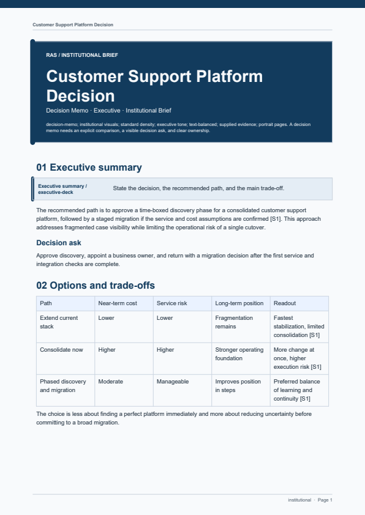
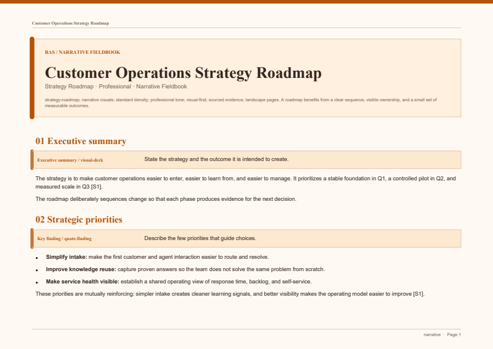
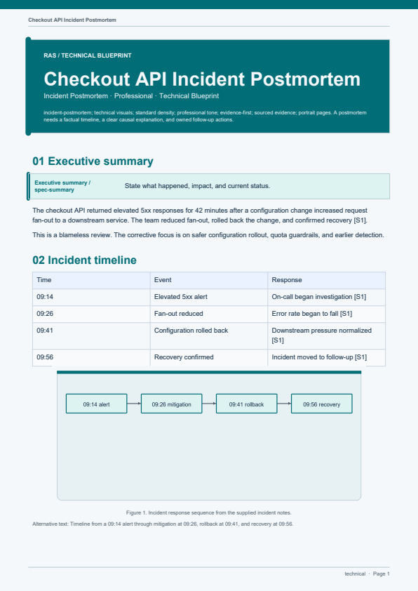

<div align="center">

<a href="https://github.com/CharlesArea/ras">
  
</a>

# RAS — Report Anything Skill

### Turn a request and its evidence into a report people will actually read.

Six visual themes · Sixteen reusable templates · DOCX + PDF + optional editable PPTX from one canonical model

<a href="#quickstart">Quickstart</a> ·
<a href="#see-it-in-action">See it in action</a> ·
<a href="#design-system">Design system</a> ·
<a href="#evidence-model">Evidence model</a> ·
<a href="#development">Development</a>

</div>

<div align="center">

<a href="https://www.python.org/"></a>
<a href="https://nodejs.org/"></a>
<a href="https://yaml.org/"></a>
<a href="https://www.markdownguide.org/"></a>
<a href="https://github.com/CharlesArea/ras"></a>


</div>

<div align="center">

**One request. One canonical model. DOCX, PDF, and an optional editable PPTX companion.**


</div>

## Why RAS

Most report automation stops at text. RAS treats a report as a designed, auditable artifact: it chooses the communication shape, keeps the evidence trail visible, resolves a visual system, renders DOCX and PDF from the same model, optionally adds an editable PPTX companion, and checks the outputs before delivery.

Ask for the outcome in plain language:

> “Compare the options for the board and recommend a path.”

> “Create a KPI review with a clear trend chart.”

> “Turn this research into an evidence-grounded synthesis.”

> “Explain the incident, root cause, impact, and corrective actions.”

RAS turns the request into a structured project with independent Markdown blocks, a source ledger, a visual contract, and a quality receipt.

## See it in action

These previews are rendered from the examples and acceptance fixtures in this repository—not stock mockups.

<table>
  <tr>
    <td width="50%"></td>
    <td width="50%"></td>
  </tr>
  <tr>
    <td align="center"><sub>Data-forward KPI review</sub></td>
    <td align="center"><sub>Technical architecture report</sub></td>
  </tr>
</table>

<table>
  <tr>
    <td width="50%"></td>
    <td width="50%"></td>
  </tr>
  <tr>
    <td align="center"><sub>Editorial executive brief</sub></td>
    <td align="center"><sub>Analytical comparison with chart</sub></td>
  </tr>
</table>

<table>
  <tr>
    <td width="33%"></td>
    <td width="33%"></td>
    <td width="33%"></td>
  </tr>
  <tr>
    <td align="center"><sub>Decision memo template</sub></td>
    <td align="center"><sub>Strategy roadmap template</sub></td>
    <td align="center"><sub>Incident postmortem template</sub></td>
  </tr>
</table>

### Editable PPTX companions

The presentation renderer adapts the same report package into a widescreen,
editable deck. The showcase economy report keeps its growth chart native,
preserves the source register as an editable table, and carries full source
references plus block text in speaker notes.

<table>
  <tr>
    <td width="33%"></td>
    <td width="33%"></td>
    <td width="33%"></td>
  </tr>
  <tr>
    <td align="center"><sub>Deck cover</sub></td>
    <td align="center"><sub>Native chart slide</sub></td>
    <td align="center"><sub>Editable source register</sub></td>
  </tr>
</table>

## Install

```bash
git clone https://github.com/CharlesArea/ras.git
cd ras
python -m pip install -e ".[render]"
```

The host-facing skill lives at [`skills/ras/SKILL.md`](skills/ras/SKILL.md). Codex and Claude plugin manifests are included in [`.codex-plugin`](.codex-plugin/plugin.json) and [`.claude-plugin`](.claude-plugin/plugin.json).

## Quickstart

Initialize a report project:

```bash
ras-report init reports/my-report \
  --request "Create an evidence-grounded decision memo from these notes" \
  --archetype decision-memo
```

Depth is inferred from ordinary language. Keep the workflow one prompt long,
or override it when the output needs a deliberate size or research mode:

```bash
ras-report init reports/economy-deep-dive \
  --request "Create a detailed comparison of the economy before and after COVID" \
  --depth deep --research web --pages 15
```

The available profiles are `quick`, `standard`, and `deep`. Inspect the
resolved plan at any time with `ras-report plan <manifest>`.

Edit the generated `manifest.yaml`, `sources.yaml`, and Markdown blocks, then validate, build, and inspect the result:

```bash
ras-report validate reports/my-report/manifest.yaml
ras-report build reports/my-report/manifest.yaml --formats docx,pdf,pptx
ras-report qa reports/my-report/manifest.yaml
```

DOCX and PDF are the core outputs and work with the Python render extra. PPTX
is an optional editable companion generated with the host's bundled Node.js and
Artifact Tool presentation runtime.

### Output targets

| Format | Support | Runtime |
| --- | --- | --- |
| DOCX | Core output | Python with `python-docx` |
| PDF | Core output | Python with ReportLab |
| PPTX | Optional editable companion | Host Node.js and Artifact Tool runtime |

Scaffold a fuller package from the reusable template catalog:

```bash
ras-report template list
ras-report init reports/board-decision --template decision-memo \
  --request "Compare the options and recommend a path for the board"
```

Explore the visual language:

```bash
ras-report theme list
ras-report theme inspect data-forward
```

<details>
<summary><strong>What a report project contains</strong></summary>

```text
reports/my-report/
├── manifest.yaml       # request, style decision, blocks, outputs, QA receipt
├── sources.yaml        # provenance and claim support
├── blocks/*.md         # independent, resumable content units
├── assets/             # supplied or generated visual assets
├── build/              # canonical model and intermediate visuals
├── qa/                 # receipts and rendered page images
└── dist/               # final DOCX, PDF, and optional PPTX outputs
```

</details>

## What it makes

RAS supports reports that need structure, judgment, and traceability:

| Intent | Useful for |
| --- | --- |
| Executive brief | Senior-management summaries and concise reviews |
| Decision memo | Options, trade-offs, recommendations, and next actions |
| Research synthesis | Evidence-led findings across multiple sources |
| Analytical deep dive | Trends, causes, implications, and interpretation |
| Comparative evaluation | Before/after, option, vendor, or policy comparisons |
| Proposal and roadmap | Business cases, strategies, plans, and milestones |
| KPI and status review | Metrics, charts, progress, and operating cadence |
| Audit, risk, and compliance | Controls, evidence gaps, findings, and mitigations |
| Technical report | Architecture, systems, incidents, and investigations |
| SOP and case study | Repeatable procedures and documented examples |

Sixteen archetypes are available in the router, with explicit overrides when the request already tells RAS what shape it should take.

### Reusable templates

Templates are scaffolded block sets, not locked layouts. They give the host a
strong starting structure while keeping every block independently editable and
resumable:

| Template family | Included shapes |
| --- | --- |
| Decision and comparison | Decision memo, comparative evaluation, proposal/business case |
| Research and analysis | Research synthesis, analytical deep dive, investigation/root cause |
| Operating cadence | Status/progress, performance/KPI, strategy roadmap |
| Risk and assurance | Audit assessment, compliance/risk, incident postmortem |
| Technical and procedural | Technical architecture, policy/SOP, case study |

Inspect the exact block blueprint with `ras-report template inspect <template>`.

### Lightweight content planning

Every new package records a content plan automatically. It contains a target
page range, word range, slide target, and a per-section word budget. A request
such as “give me a detailed analysis” selects the deep profile; a request such
as “write a concise brief” selects quick. The host can use the plan to expand
context, evidence, implications, and limitations without asking a long intake
questionnaire.

## How it works

### 1 · Route the request

RAS resolves the archetype, audience, tone, evidence level, page geometry, visual style, density, and emphasis from the request. Explicit user choices win.

### 2 · Plan the content

The planner resolves depth, target pages, section budgets, and research mode.
The default research mode uses supplied material. External research requires
the explicit `web` mode or a clear user request.

### 3 · Build independent blocks

Each block has a stable ID, communication goal, status, source references, layout budget, and optional visual contract. A single block can be regenerated without disturbing the rest of the report.

### 4 · Resolve one design system

The design compiler resolves the theme, brand tokens, semantic components, typography, chart palette, diagram language, spacing, and page rhythm before rendering begins.

### 5 · Render and verify

DOCX and PDF are produced from the same canonical model, while PPTX adds a
native editable presentation companion: charts remain PowerPoint charts, tables
remain editable tables, and source references plus full block text are retained
in speaker notes. QA checks output structure, section parity, accessibility
metadata, PDF readability, and rendered-page integrity.

## Design system

Themes are not just color presets. They change the report’s hierarchy, cover treatment, semantic panels, tables, charts, diagrams, typography, spacing, and composition rules.

| Theme | Personality | Best for |
| --- | --- | --- |
| `minimal` | Quiet and compact | Short, low-ornament reports |
| `editorial` | Warm and narrative | Executive briefs and story-led work |
| `data-forward` | Crisp and metric-led | KPIs, comparisons, and dashboards |
| `institutional` | Formal and structured | Policy, audit, and compliance |
| `technical` | Blueprint-like and precise | Architecture and operations |
| `narrative` | Expressive and paced | Case studies and long-form synthesis |

A project-level `.ras/brand.yaml` can overlay the theme with brand colors, fonts, spacing, component tokens, chart palettes, and diagram tokens. Inline Markdown formatting—**bold**, *italic*, and `code`—is supported consistently across the requested output formats.

## Evidence model

User-provided material is the primary evidence. External research is used only when the user requests or clearly authorizes it.

The source ledger records provenance:

```yaml
sources:
  - id: S1
    title: Official source title
    publisher: Publisher
    url: https://example.com/source
    publication_date: "2026-01-01"
```

Blocks cite source records with stable markers:

```markdown
The supported finding is stated here [S1].
```

Validation checks that source references resolve, claims are supported, required visuals have captions and alternative text, unsafe paths are rejected, and unresolved placeholders do not reach the deliverable.

## Visuals and accessibility

Charts accept `bar`, `line`, and `pie` specifications with labels, values, captions, and alternative text. Diagrams use a small semantic grammar and render to original SVG and PNG assets.

Informative visuals receive:

- a visible caption;
- alternative text in the report;
- embedded image metadata in DOCX;
- a deterministic asset in the build model.

The built-in visual pipeline is dependency-light: Pillow and SVG primitives handle charts and diagrams, while ReportLab and python-docx produce the final documents.

## Examples and fixtures

- [`examples/executive-brief`](examples/executive-brief) — editorial management review
- [`examples/kpi-report`](examples/kpi-report) — data-forward chart report
- [`examples/technical-report`](examples/technical-report) — technical report with diagram
- [`examples/decision-memo`](examples/decision-memo) — reusable decision template with options and recommendation
- [`examples/strategy-roadmap`](examples/strategy-roadmap) — priorities, milestones, and measures
- [`examples/incident-postmortem`](examples/incident-postmortem) — blameless incident timeline and corrective actions
- [`fixtures/traditional-chinese`](fixtures/traditional-chinese) — CJK rendering acceptance fixture
- [`fixtures/insufficient-evidence`](fixtures/insufficient-evidence) — evidence-gap behavior fixture
- [`reports/covid-economy-comparison`](reports/covid-economy-comparison) — sourced global before/after comparison package

Generated `build/`, `qa/`, and `dist/` directories are ignored so source packages stay reviewable and reproducible.

## Development

Run the standard-library test suite:

```bash
python -m unittest discover -s tests -v
```

For a full acceptance pass:

```bash
python -m unittest discover -s tests -v
ras-report validate examples/executive-brief/manifest.yaml
ras-report build examples/executive-brief/manifest.yaml --formats docx,pdf,pptx
ras-report qa examples/executive-brief/manifest.yaml
```

Optional render dependencies are declared in [`pyproject.toml`](pyproject.toml):

```bash
python -m pip install -e ".[render]"
```

## Scope

RAS v1 focuses on evidence-grounded DOCX and PDF reports, optional editable
PPTX companions, reusable templates, and lightweight content planning. Web
reports, spreadsheet appendices, and collaborative editing workflows remain
outside the current renderer contract.

## License

See [`LICENSE`](LICENSE).
